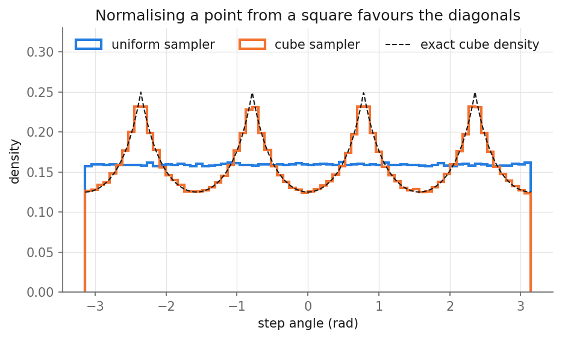
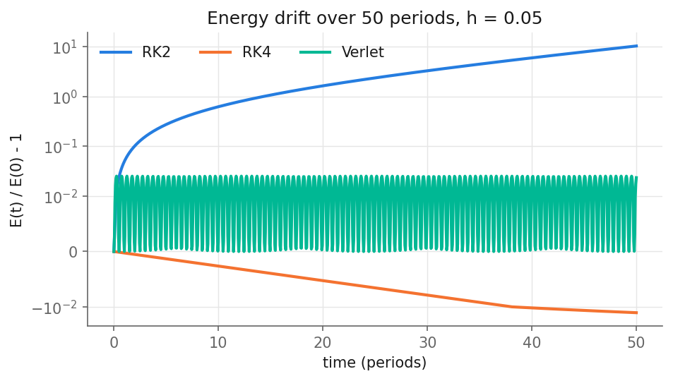
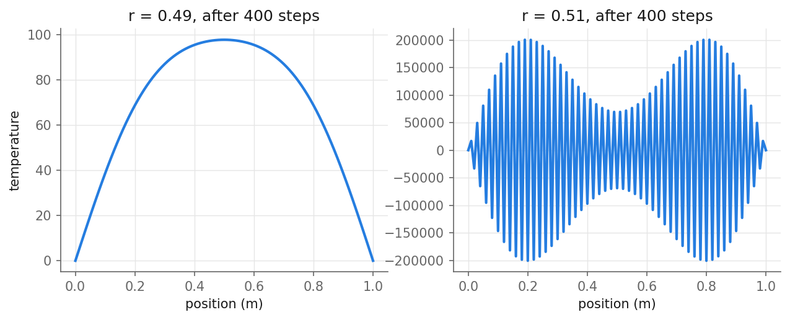
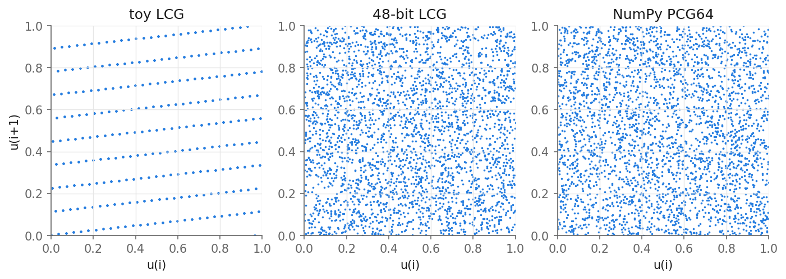
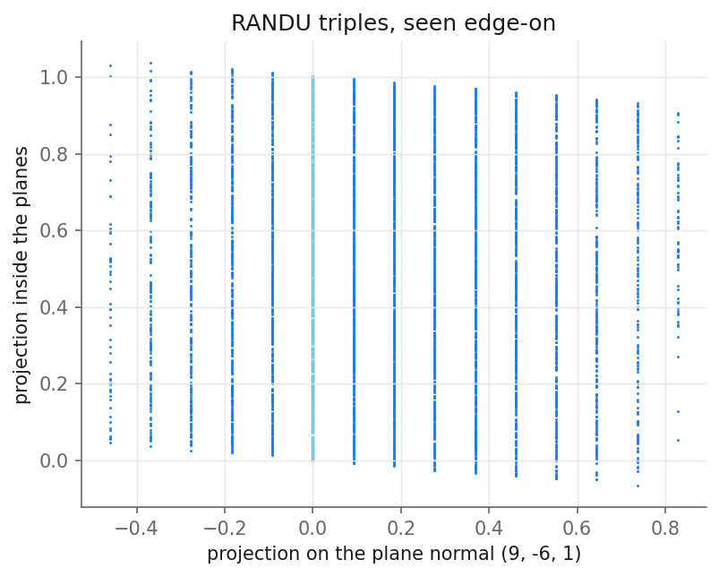
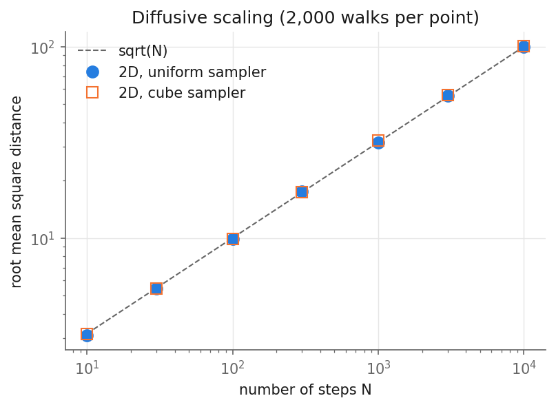
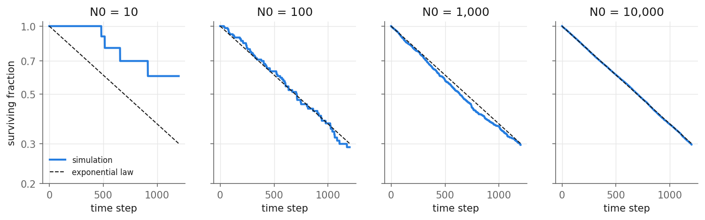
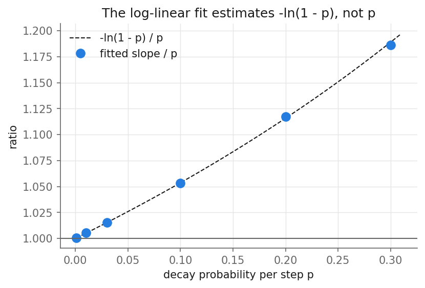

# Computational physics simulations

Oscillators, heat flow and Monte Carlo experiments in plain NumPy, each one checked against theory.



The work started as team projects for a Computer Modelling course during an exchange semester in Kraków (2025/26). This repository reorganises it into a small tested package with one script that regenerates every figure and number below.

## What is inside

| Topic | Question | Module |
|---|---|---|
| Harmonic oscillator | How do RK2, RK4, velocity Verlet and adaptive RKF45 compare? | `simphys/ode.py` |
| Heat equation | Does an explicit finite difference scheme reproduce the Fourier solution, and when does it blow up? | `simphys/heat.py` |
| Random numbers | What makes a generator bad, and which tests notice? | `simphys/rng.py` |
| Random walks | Does distance grow like the square root of the number of steps? | `simphys/random_walk.py` |
| Radioactive decay | How does an exponential law emerge from coin flips, and what does a log fit estimate? | `simphys/decay.py` |

There are no external datasets. Everything is simulated.

## Results

All values come from `python run_all.py`, saved in [`results/summary.json`](results/summary.json).

### Oscillator (period T = 1)

| Method | Observed order | Max position error, h = 0.1, 10 periods | Max relative energy error, h = 0.05, 50 periods |
|---|---|---|---|
| RK2 (midpoint) | 2.00 | 1.17 | 10.4 |
| Velocity Verlet | 2.00 | 0.165 | 0.025 |
| RK4 | 4.00 | 0.012 | 0.013 |

RK2 and Verlet share the same order, yet RK2 pumps energy into the system while Verlet's error stays bounded. RK4 is far more accurate per step, but its energy still drifts slowly in one direction. The adaptive RKF45 solver covers 10 periods in 657 accepted steps (6 rejected) with a maximum error of 9.3e-8.



### Heat flow in a metal bar

A 1 m bar starts at 100 degrees with both ends held at 0.

* After 4500 s the centre is at 1.7 degrees for aluminium and 46.6 for iron, as expected from a diffusivity about 4.3 times higher.
* Against the Fourier series, the aluminium run is off by at most 0.0011 degrees at that time.
* The scheme is stable for `r = alpha dt / dx^2 <= 1/2`. After 400 steps, r = 0.49 gives a smooth profile and r = 0.51 reaches values around 2e5.
* The measured spatial order is 1.97 for r = 0.4. At the special value r = 1/6 the leading error terms cancel and the order rises to 4.15.



The package also covers a Newton cooling term (extra losses to the environment) and two bars in contact.

### Random number generators

100,000 samples from each generator. The chi-square statistic is computed on non-overlapping pairs on a 16 x 16 grid (255 degrees of freedom).

| Generator | Largest moment error (k = 1..5) | Lag 1 correlation (ideal 0.25) | Pair chi-square |
|---|---|---|---|
| Toy LCG (a=57, c=1, m=256) | 0.0019 | 0.256 | 50,000 |
| 48-bit LCG (drand48 constants) | 0.0006 | 0.251 | 258 |
| NumPy PCG64 | 0.0008 | 0.249 | 278 |

The toy generator has the longest period its modulus allows (256) and its moments look reasonable. Plot consecutive values and the problem is obvious. RANDU, a classic bad generator, hides its flaw one dimension higher: all its consecutive triples fall on 15 planes.




### Random walks

With 2,000 walks per point and N from 10 to 10,000, the fitted exponent of the root mean square distance is 0.503 in 2D and 0.499 in 3D (theory: 0.5).

**A correction to our original report.** The report describes each step as a uniformly random angle, but the code drew a point uniformly in a square and normalised it. Those directions are not uniform: the density along a diagonal is exactly twice the density along an axis (figure at the top). The scaling result survives because each step still has zero mean and the same covariance, so the mean squared distance is N either way. With the square sampler the exponents are 0.503 (2D) and 0.502 (3D). Both samplers are available and tested.



### Radioactive decay

Each nucleus decays with probability p per time step.



Over 200 runs with p = 0.001, the rate fitted from ln N(t) averages 0.00100 and its standard deviation shrinks from 1.4e-4 (100 nuclei) to 1.2e-5 (10,000 nuclei).

The fit does not estimate p itself. It estimates `-ln(1 - p)`, which matters once p is no longer tiny: at p = 0.3 the fitted rate is 19% larger than p.



## Reproduce

Python 3.11.

```bash
pip install -r requirements.txt
python run_all.py            # all figures and results/summary.json, a few minutes
python run_all.py heat rng   # only some sections
pytest                       # 25 tests
```

Random sections are seeded. Small numerical differences are possible across NumPy versions.

## Reports

The two original written reports are in [`reports/`](reports/): [heat flow](reports/heat_flow_report.pdf) and [Monte Carlo methods](reports/monte_carlo_report.pdf). They reflect the original code, including the sampling detail corrected above. There is no separate report for the oscillator work.

## Authorship

Team: **Tadeo Kaufmann**, **Vadym Vovk** and **Emirhan Onal**.

The `simphys` package, `run_all.py` and the tests were written when preparing this repository, rebuilding the team's original scripts into reusable functions. The following were added at that stage and are not part of the reports: the velocity Verlet comparison, the convergence and r = 1/6 studies, RANDU and the chi-square test, the second direction sampler and its exact density, and the decay rate bias analysis.

## References

* R. H. Landau, M. J. Páez and C. C. Bordeianu, *Computational Physics: Problem Solving with Python*. Background for the heat flow and Monte Carlo experiments.
* W. H. Press et al., *Numerical Recipes*, 3rd ed., Cambridge University Press, 2007.
